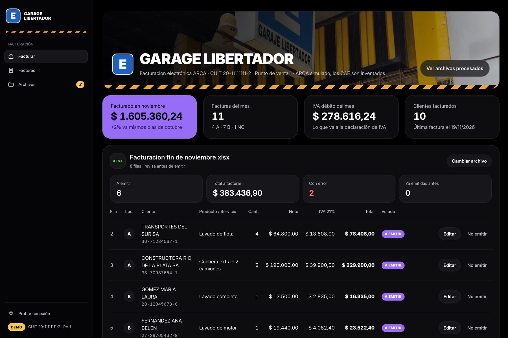
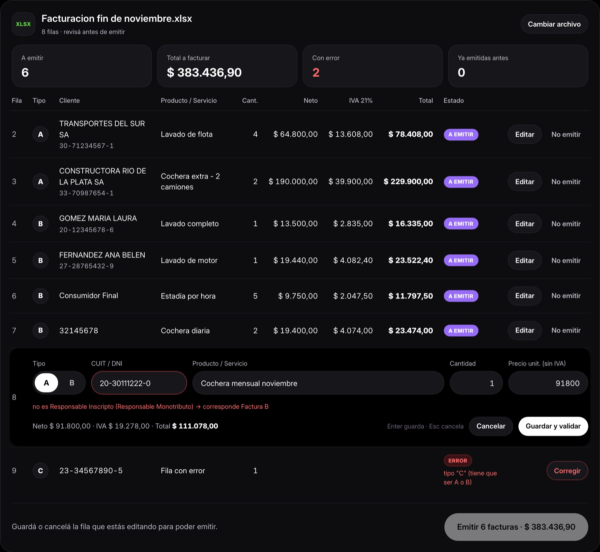
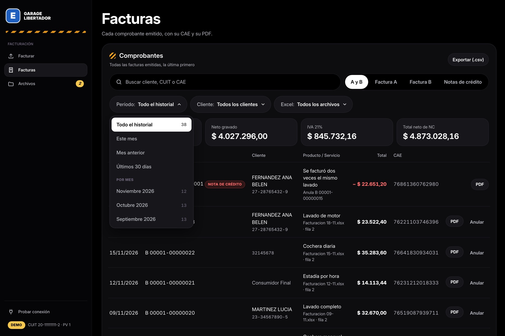
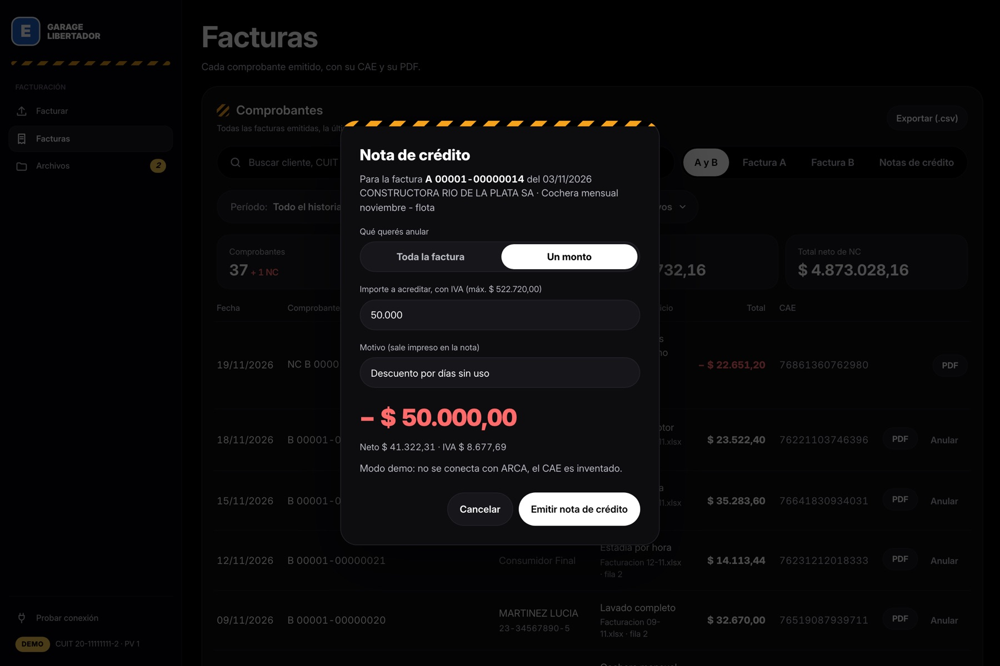
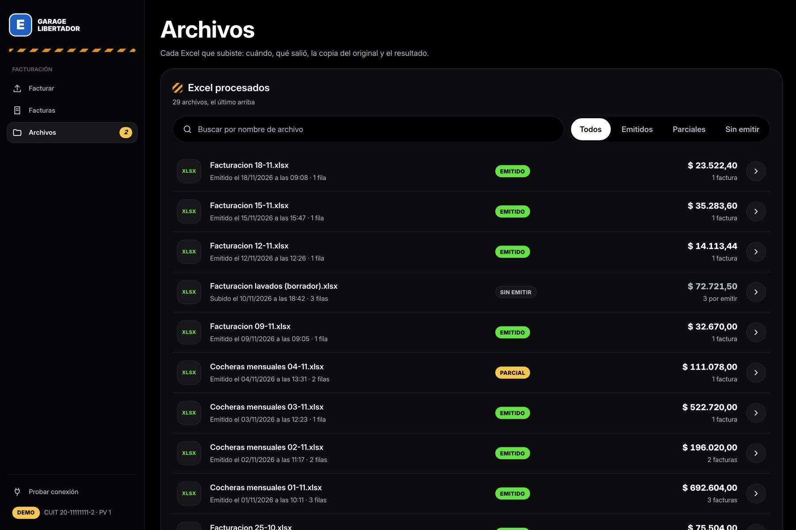
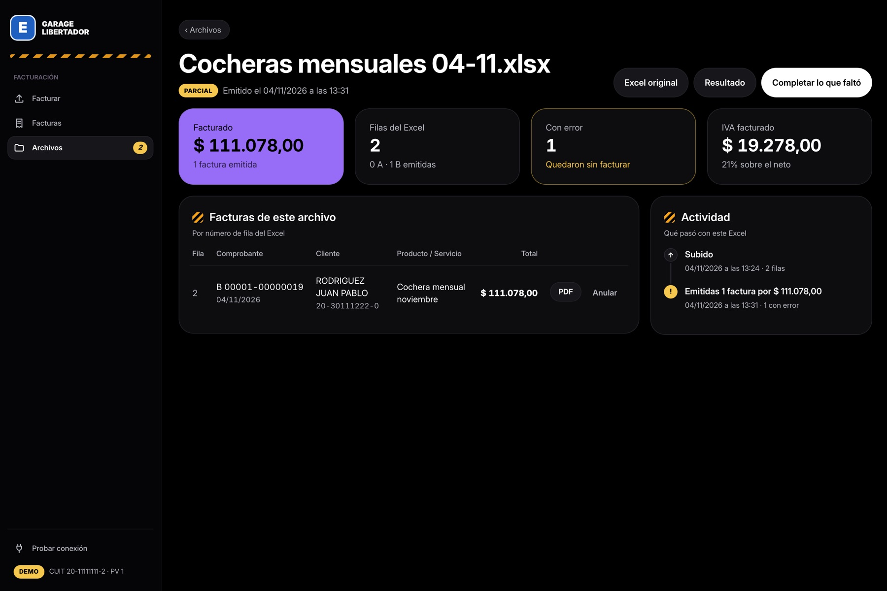
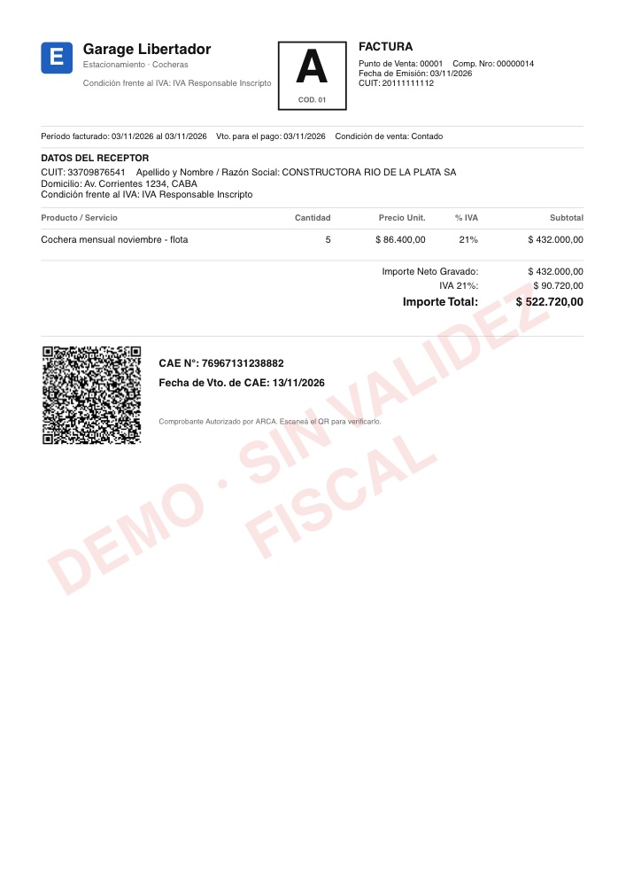

<div align="center">

# Garage Libertador · Facturador ARCA

**Subís un Excel, revisás cada factura y la emite en ARCA con CAE, PDF y QR.**
Facturas A y B, notas de crédito, historial y archivos procesados, todo desde un panel local.



</div>

---

## Qué hace

- **Factura desde un Excel.** Una fila es una factura: tipo A/B, CUIT o DNI, producto, cantidad y precio. Concepto
  *Servicios*, condición *Contado*, IVA 21 %.
- **Nunca emite a ciegas.** Al soltar el Excel arma una **vista previa** con cliente, neto, IVA y total de cada fila.
  Nada sale hasta que apretás *Emitir* y confirmás.
- **Corregís sin volver al Excel.** Cada fila se edita ahí mismo (tipo, CUIT, producto, cantidad, precio) y se vuelve
  a validar al instante. También se puede **saltear** una fila.
- **Valida contra ARCA antes de emitir.** Consulta el padrón para traer el **nombre del cliente** y verificar su
  condición de IVA: si cargaste una Factura A a un monotributista, te avisa *"corresponde Factura B"*.
- **Emite de verdad.** WSAA + WSFEv1 de ARCA: pide el CAE, numera solo y arma el **PDF** con el **QR** de la RG 4892.
- **Notas de crédito.** Anulás una factura entera o un monto, con el motivo impreso. La nota sale con la misma letra y
  asociada a la factura original.
- **No factura dos veces.** Cada fila emitida queda registrada por huella del archivo + número de fila. Si se corta
  internet justo al emitir, la próxima vez le pregunta a ARCA si salió antes de reintentar.
- **Historial completo.** Todas las facturas con filtros por período, cliente, archivo y tipo, totales y exportación a
  CSV. Cada Excel procesado guarda la **copia del original**, el **resultado** y lo que pasó con él.

## Capturas

| Revisar y corregir antes de emitir | Facturas con filtros |
|---|---|
|  |  |
| **Nota de crédito total o parcial** | **Archivos procesados** |
|  |  |
| **Detalle de un archivo** | **El PDF que recibe el cliente** |
|  |  |

## Cómo funciona

```
 Excel ──▶ vista previa ──▶ vos revisás / editás ──▶ Emitir
              │                                        │
              └─ padrón ARCA (nombre + cond. IVA)       ▼
                                          WSAA (certificado → ticket 12 h)
                                                       │
                                          WSFEv1 FECAESolicitar → CAE
                                                       │
                              PDF con QR · registro anti-duplicados · historial
```

La autenticación y la emisión son las mismas que usa Previate Esta en producción (`services/afip/` de la API),
adaptadas a una app local sin base de datos.

---

## Probalo en 2 minutos, sin certificado

```sh
git clone https://github.com/tomymiron/GarageLibertador.git && cd GarageLibertador
npm install
npm run demo:datos   # 3 meses de facturas de ejemplo
npm run demo         # abre el panel con ARCA simulado
```

En modo **demo** no se conecta con ARCA: los CAE son inventados y los PDFs dicen *"DEMO · SIN VALIDEZ FISCAL"*. Para
ver la vista previa con un Excel ya cargado, abrí `http://localhost:3737/?ejemplo`.

## Ponerlo en producción

Hace falta un **certificado digital de ARCA** a nombre del CUIT del garage. Hay dos caminos:

| | |
|---|---|
| 📄 **A mano, ~15 min** | [`docs/certificado-arca.md`](docs/certificado-arca.md): paso a paso con cada clic en ARCA. |
| 🤖 **Que lo haga Claude** | [`docs/PROMPT-CLAUDE.md`](docs/PROMPT-CLAUDE.md): un prompt para Claude Code + la extensión de Chrome. Vos solo iniciás sesión en ARCA. |

Al final, `npm run probar` tiene que dar todo en ✓:

```
✓ .env completo                          CUIT 30712345678 · Punto de venta 2
✓ Certificado y clave privada            facturador · válido hasta 19/11/2028
✓ Servidores de ARCA                     app OK · db OK · auth OK
✓ Autenticación para facturar (wsfe)
✓ Punto de venta 2 habilitado para Factura A
✓ Punto de venta 2 habilitado para Factura B
✓ Padrón de ARCA                         tu CUIT figura como GARAGE LIBERTADOR SRL
```

---

## Uso diario

Doble clic en **`Abrir panel.command`** o `npm run panel`. Abre `http://localhost:3737`.

1. **Facturar**: arrastrás el Excel, revisás la vista previa, corregís lo que haga falta y apretás **Emitir**.
2. **Facturas**: cada comprobante con su CAE y su PDF. **Anular** emite la nota de crédito.
3. **Archivos**: cada Excel subido con la copia del original, el resultado y la actividad. Si quedó algo sin emitir,
   *Retomar* o *Completar lo que faltó*.

El panel escucha solo en `127.0.0.1`, así que no queda expuesto a la red.

### Formato del Excel

La fila 1 tiene los títulos. Las columnas se encuentran **por el título**, no por la letra:

| TIPO DE COMPROBANTE A/B | CUIT | Producto/Servicio | Cantidad | Precio Unitario |
|---|---|---|---|---|
| A | 30-71234567-1 | Cochera mensual noviembre | 1 | 85000 |
| B | 20-12345678-6 | Lavado completo | 2 | 12500,50 |
| B | 32145678 | Cochera diaria | 1 | 9000 |
| B | *(vacío)* | Estadía por hora | 3 | 1500 |

- **A**: CUIT de un Responsable Inscripto.
- **B**: CUIT (monotributista o exento), DNI o vacío (consumidor final).
- Los números aceptan `12500,50`, `12.500,50` o `$ 12500.5`.
- Las columnas que empiezan con *"detalles:"* se ignoran.
- Ejemplo listo en [`ejemplo/`](ejemplo/).

### Por terminal

```sh
npm run facturar -- ~/Downloads/archivo.xlsx --simular   # solo el resumen, no emite
npm run facturar -- ~/Downloads/archivo.xlsx             # resumen + confirmación + emisión
```

---

## Comandos

| Comando | Qué hace |
|---|---|
| `npm run panel` | Panel web en `localhost:3737` y lo abre en Safari |
| `npm run probar` | Chequea certificado, ARCA, punto de venta y padrón. No emite nada |
| `npm run facturar -- <xlsx>` | Factura desde la terminal (`--simular`, `--si`) |
| `npm run generar-clave -- <CUIT> "<Razón>"` | Crea `clave.key` + `pedido.csr` para ARCA |
| `npm run demo` | Panel con ARCA simulado |
| `npm run demo:datos` / `demo:vaciar` | Carga o borra los datos de ejemplo de la demo |

## Configuración (`.env`)

| Variable | Ejemplo | |
|---|---|---|
| `ARCA_ENV` | `produccion` | `produccion` · `homologacion` (pruebas) · `demo` (simulado) |
| `CUIT` | `30712345678` | CUIT del garage, sin guiones |
| `PUNTO_DE_VENTA` | `2` | Punto de venta tipo *Web Services* |
| `CERTIFICADO` / `CLAVE_PRIVADA` | `certificados/certificado.crt` | Rutas al certificado y la clave |
| `PRECIO_INCLUYE_IVA` | `no` | `no`: al precio se le suma 21 % · `si`: el precio ya lo incluye |
| `NOMBRE_COMERCIAL`, `RAZON_SOCIAL`, `DOMICILIO_FISCAL`, `INGRESOS_BRUTOS`, `INICIO_ACTIVIDADES` | | Se imprimen en el PDF |
| `COND_IVA_B_POR_DEFECTO` | `6` | Condición asumida para una B con CUIT si el padrón no responde |

## Dónde queda cada cosa

```
certificados/         clave.key · pedido.csr · certificado.crt   (no se versiona)
datos/                registro anti-duplicados, tickets de ARCA, archivos procesados y sus copias   (no se versiona)
facturas/AAAA-MM-DD/  PDFs y Excel de resultado de cada día   (no se versiona)
src/
  wsaa.js             autenticación con certificado (CMS firmado → token 12 h)
  wsfe.js             FECAESolicitar · FECompUltimoAutorizado · FECompConsultar (+ ARCA simulado)
  padron.js           ws_sr_constancia_inscripcion (nombre y condición IVA del cliente)
  motor.js            vista previa, edición, emisión, notas de crédito, historial y archivos
  excel.js · pdf.js   lectura del Excel · PDF con QR (RG 1415 / RG 4892)
  server.js           API del panel (solo 127.0.0.1)
public/index.html     el panel (sin build, sin dependencias en el navegador)
docs/                 certificado de ARCA · prompt para Claude · capturas
```

## Seguridad

- **`certificados/clave.key` es la llave del CUIT.** Nunca se commitea ni se comparte. Hacele backup aparte.
- `.env`, `certificados/`, `datos/` y `facturas/` están en el `.gitignore`.
- El panel solo acepta conexiones de la propia Mac.
- Una factura emitida **no se borra**: se anula con nota de crédito.

## Preguntas frecuentes

<details><summary><b>¿Qué pasa si subo dos veces el mismo Excel?</b></summary>

Las filas ya facturadas aparecen como *"Ya emitidas antes"* y no se vuelven a emitir. En **Archivos** se suma a la
misma entrada ("se cargó 2 veces").
</details>

<details><summary><b>¿Y si se corta internet en medio de la emisión?</b></summary>

El facturador frena. La próxima vez que subas el Excel le pregunta a ARCA (`FECompConsultar`) si esa factura llegó a
salir: si salió la registra, y si no la deja lista para emitir. Nunca adivina.
</details>

<details><summary><b>¿El precio del Excel lleva IVA?</b></summary>

Depende de `PRECIO_INCLUYE_IVA`. Por defecto **no**: el precio es neto y se le suma el 21 %. La vista previa muestra
neto, IVA y total antes de emitir, así que cualquier confusión se ve ahí.
</details>

<details><summary><b>¿Cuándo vence el certificado?</b></summary>

A los 2 años. `npm run probar` muestra la fecha y avisa si venció. Se renueva repitiendo los pasos 1 a 3 de
[`docs/certificado-arca.md`](docs/certificado-arca.md).
</details>

---

<sub>Hecho para el Garage Libertador. Autenticación y facturación basadas en el módulo AFIP de Previate Esta.
Tipografía Inter (SIL Open Font License).</sub>
